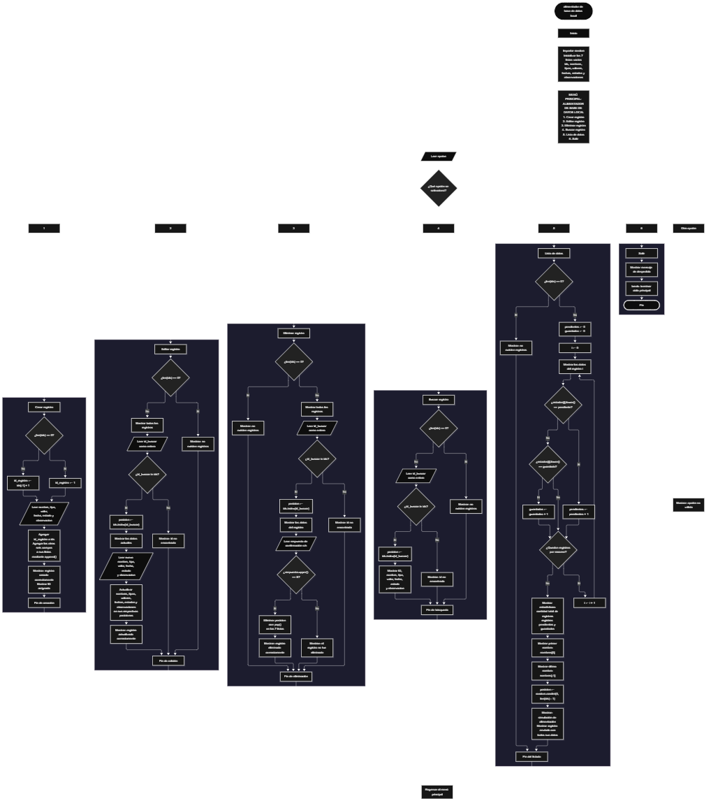

 

Este proyecto, llamado <b>alimentador de base de datos local</b>, fue desarrollado en <b>python</b> como un ejercicio práctico para fortalecer la lógica de programación mediante la creación de un sistema de administración de registros desde la consola. El programa cuenta con un menú principal de seis opciones que permite <b>crear, editar, eliminar, buscar y listar registros</b>, además de finalizar la ejecución. Cada registro almacena información como el nombre, el tipo de dato, el valor, la fecha, el estado y las observaciones, utilizando siete listas paralelas que mantienen relacionados los datos mediante sus posiciones. Durante su desarrollo se aplicaron conceptos fundamentales de programación, como variables, listas, estructuras condicionales, ciclos repetitivos, búsqueda por identificador, manipulación de cadenas y generación de valores aleatorios. También se implementaron estadísticas para contabilizar los registros pendientes y guardados, así como una simulación de alimentación de datos mediante la selección aleatoria de un registro. La información se mantiene temporalmente en memoria durante la ejecución, sin utilizar una base de datos real ni guardar los registros en archivos. Este proyecto permite poner en práctica los conocimientos adquiridos en python y sirve como base para desarrollar sistemas de administración de datos más avanzados.

<h2 align="center">⚙️ Funcionamiento del menú principal</h2>

### ➕ Crear registro

La opción <b>1) crear registro</b> permite agregar un nuevo registro al sistema. Antes de solicitar los datos, el programa comprueba si la lista <b>ids</b> está vacía mediante la condición <b>len(ids) == 0</b>. Si no existen registros, asigna el identificador inicial <b>1</b> a la variable <b>id_registro</b>. Si ya hay registros almacenados, obtiene el siguiente identificador sumando uno al último elemento de la lista mediante la expresión <b>ids[-1] + 1</b>. Después, solicita el <b>nombre del registro, tipo de dato, valor, fecha, estado y observación</b>. Los datos se incorporan a sus respectivas listas mediante el método <b>append()</b>, conservando la correspondencia entre las posiciones. Finalmente, muestra el mensaje <b>"registro creado correctamente."</b> y presenta el identificador asignado. El estado se solicita mediante una entrada de texto que indica las opciones <b>pendiente o guardado</b>, aunque el programa no restringe los valores introducidos a esas dos opciones.

### ✏️ Editar registro

La opción <b>2) editar registro</b> permite modificar la información de un registro existente. Primero, el programa comprueba si la lista <b>ids</b> está vacía. Si no existen registros, muestra el mensaje <b>"no existen registros."</b>. En caso contrario, presenta una lista con el identificador, nombre, tipo, valor, fecha, estado y observación de cada registro, utilizando un ciclo <b>for</b> para recorrer las listas. Después, solicita el identificador que se desea editar mediante la variable <b>id_buscar</b>, convirtiendo la entrada a un número entero con <b>int()</b>. Si el identificador existe en la lista <b>ids</b>, utiliza <b>ids.index(id_buscar)</b> para obtener su posición y mostrar los datos actuales. A continuación, solicita los nuevos valores del nombre, tipo de dato, valor, fecha, estado y observación, actualizando directamente las posiciones correspondientes de sus listas. Finalmente, muestra el mensaje <b>"registro actualizado correctamente."</b>. Si el identificador no existe, presenta el mensaje <b>"id no encontrada."</b>. El identificador original se conserva durante la edición.

### 🗑️ Eliminar registro

La opción <b>3) eliminar registro</b> permite eliminar un registro mediante su identificador. Antes de comenzar, el programa comprueba si existen registros almacenados. Si la lista <b>ids</b> está vacía, muestra el mensaje <b>"no existen registros."</b>. Si existen datos, presenta una lista de los registros con todos sus campos y solicita el identificador que se desea eliminar. El valor introducido se convierte a entero mediante <b>int()</b> y se comprueba si está presente en la lista <b>ids</b>. Cuando el identificador existe, el programa obtiene su posición con <b>ids.index(id_buscar)</b> y muestra los datos correspondientes. Después, solicita una confirmación mediante la pregunta <b>"¿desea eliminar este registro? (s/n):"</b>. Si la respuesta, convertida a mayúsculas mediante <b>respuesta.upper()</b>, es igual a <b>"S"</b>, elimina la posición seleccionada de las siete listas utilizando el método <b>pop()</b> y muestra el mensaje <b>"registro eliminado correctamente."</b>. Si la respuesta es diferente de <b>"S"</b>, informa que el registro no fue eliminado. Cuando el identificador no existe, presenta el mensaje <b>"id no encontrada."</b>.

### 🔎 Buscar registro

La opción <b>4) buscar registro</b> permite localizar un registro mediante su identificador. Primero, el programa comprueba si existen datos en la lista <b>ids</b>. Si no hay registros, muestra el mensaje <b>"no existen registros."</b>. En caso contrario, solicita el identificador que se desea buscar y convierte el valor introducido a un número entero mediante <b>int()</b>. A continuación, utiliza el operador <b>in</b> para comprobar si el identificador está presente en la lista. Si existe, obtiene su posición con <b>ids.index(id_buscar)</b> y muestra el identificador, nombre, tipo de dato, valor, fecha, estado y observación del registro encontrado. Si no existe una coincidencia, presenta el mensaje <b>"id no encontrada."</b>. Esta función permite consultar un registro específico sin necesidad de recorrer visualmente todos los datos mostrados en la lista.

### 📋 Lista de datos

La opción <b>5) lista de datos</b> permite visualizar todos los registros almacenados y consultar información general del sistema. Primero, el programa comprueba si la lista <b>ids</b> está vacía. Si no existen registros, muestra el mensaje <b>"no existen registros."</b>. Si hay información disponible, inicializa los contadores <b>pendientes</b> y <b>guardados</b> con el valor cero. Después, utiliza un ciclo <b>for</b> para recorrer las listas y mostrar los datos completos de cada registro. Durante el recorrido, analiza el estado de cada elemento mediante el método <b>lower()</b>: si el estado es igual a <b>"pendiente"</b>, aumenta el contador <b>pendientes</b> en uno; si es igual a <b>"guardado"</b>, aumenta el contador <b>guardados</b> en uno. Al finalizar, muestra la cantidad total de registros mediante <b>len(ids)</b>, el número de registros pendientes y el número de registros guardados. También presenta el primer nombre almacenado mediante <b>nombres[0]</b> y el último nombre mediante <b>nombres[-1]</b>. Finalmente, utiliza <b>random.randint(0, len(ids) - 1)</b> para seleccionar una posición aleatoria y mostrar los datos del registro elegido bajo el título <b>"simulación de alimentación de base de datos"</b>. Esta operación representa una simulación de envío, ya que el programa no establece una conexión con una base de datos real.

### 🚪 Salir del menú principal

La opción <b>6) salir</b> permite finalizar la ejecución del programa. Cuando el usuario selecciona esta opción, el sistema muestra el mensaje <b>"gracias por utilizar el alimentador de base de datos local."</b> y ejecuta la instrucción <b>break</b>, que interrumpe el ciclo principal <b>while True</b>. De esta manera, el programa deja de presentar el menú y termina su ejecución. Los registros se almacenan únicamente en las listas durante el funcionamiento del programa, por lo que no se conservan automáticamente después de cerrarlo.

<h2 align="center">🧠 Temas aplicados en el proyecto</h2>

### 📦 Variables

En este proyecto se utilizan variables para almacenar los datos introducidos por el usuario, controlar las operaciones del menú, localizar registros, gestionar la confirmación de eliminación y calcular las estadísticas. Cada variable cumple una función específica dentro del sistema y permite administrar los datos de manera organizada durante la ejecución del programa.

🔢 **Opcion:** Almacena la opción seleccionada por el usuario en el menú principal.

🆔 **Id_registro:** Almacena el identificador asignado al crear un registro.

🔎 **Id_buscar:** Almacena el identificador introducido para editar, eliminar o buscar un registro.

📍 **Posicion:** Guarda el índice del registro localizado en las listas.

📝 **Nombre, tipo, valor, fecha, estado y observacion:** Almacenan temporalmente los datos introducidos para crear un registro.

❓ **Respuesta:** Almacena la respuesta del usuario para confirmar o cancelar la eliminación de un registro.

📊 **Pendientes y guardados:** Funcionan como contadores para calcular la cantidad de registros que coinciden con cada estado reconocido.

🔄 **I:** Funciona como contador del ciclo `for` que recorre los registros.

🎲 **Random.randint():** Permite seleccionar aleatoriamente la posición del registro que se muestra durante la simulación de alimentación.

### 🗃️ Listas

El programa utiliza siete listas relacionadas para almacenar los registros. Cada lista contiene un campo específico y utiliza la misma posición para representar los datos de un mismo registro. Por ejemplo, la información del registro situado en la posición <b>0</b> se distribuye entre <b>ids[0], nombres[0], tipos[0], valores[0], fechas[0], estados[0]</b> y <b>observaciones[0]</b>. Esta organización permite recorrer, buscar, modificar, mostrar y eliminar registros manteniendo relacionados sus campos.

🆔 **Ids:** Almacena los identificadores de los registros.

📝 **Nombres:** Almacena los nombres de los registros.

🏷️ **Tipos:** Guarda el tipo de dato asociado a cada registro.

🔢 **Valores:** Almacena los valores correspondientes a los registros.

📅 **Fechas:** Guarda las fechas asociadas a cada registro.

📌 **Estados:** Almacena los estados introducidos por el usuario.

📄 **Observaciones:** Guarda las observaciones adicionales de cada registro.

### 🔀 Estructuras condicionales

En este proyecto se utilizan las estructuras <b>if, elif y else</b> para controlar el funcionamiento del menú y decidir qué operación debe ejecutarse. Estas estructuras permiten comprobar si existen registros antes de realizar una operación, determinar si un identificador está almacenado, decidir si debe eliminarse un registro según la confirmación del usuario y clasificar los estados durante el cálculo de las estadísticas. También permiten mostrar mensajes diferentes cuando un registro no existe o cuando se introduce una opción que no está contemplada en el menú.

### 🔄 Estructuras repetitivas

El programa utiliza los ciclos <b>while</b> y <b>for</b> para ejecutar y controlar sus operaciones. El ciclo <b>while True</b> mantiene activo el menú principal hasta que se selecciona la opción de salida y se ejecuta <b>break</b>. Por otro lado, los ciclos <b>for</b> recorren la cantidad de registros almacenados para mostrar sus datos, presentar la lista antes de editar o eliminar y calcular las estadísticas de los estados. Estos ciclos permiten procesar los registros sin tener que escribir instrucciones individuales para cada elemento.

### 🎯 Selección de opciones

La selección de operaciones se realiza mediante una estructura condicional compuesta por <b>if, elif y else</b>. El programa compara la variable <b>opcion</b> con los valores de texto del <b>"1"</b> al <b>"6"</b> y ejecuta el bloque correspondiente. Cada opción representa una operación del sistema: crear, editar, eliminar, buscar, listar datos o salir. Cuando el valor introducido no coincide con ninguna opción definida, se ejecuta el bloque <b>else</b>, que muestra el mensaje <b>"opción no válida."</b>.

### 🔍 Búsqueda por identificador

El programa utiliza el operador <b>in</b> y el método <b>index()</b> para localizar registros mediante sus identificadores. Primero, comprueba si el valor de <b>id_buscar</b> se encuentra en la lista <b>ids</b>. Si existe, utiliza <b>ids.index(id_buscar)</b> para obtener la posición correspondiente. Esa posición se utiliza para acceder a los datos relacionados en las demás listas. Esta técnica se aplica en las operaciones de edición, eliminación y búsqueda, evitando acceder a una posición sin haber comprobado previamente que el identificador existe.

### 📊 Contadores y estadísticas

El sistema calcula estadísticas durante la ejecución de la opción <b>5) lista de datos</b>. Para ello, inicializa las variables <b>pendientes</b> y <b>guardados</b> en cero y recorre los estados almacenados. Cuando encuentra el texto <b>"pendiente"</b>, incrementa el contador correspondiente; cuando encuentra <b>"guardado"</b>, incrementa el otro contador. Además, utiliza <b>len(ids)</b> para calcular el total de registros y muestra el primer y último nombre de la lista. Los estados que no coinciden con las dos categorías reconocidas se muestran en el listado, pero no se incluyen en ninguno de los contadores de estado.

### 🎲 Generación de valores aleatorios

El programa importa el módulo <b>random</b> para seleccionar un registro de manera aleatoria durante la opción de listado. Mediante la función <b>random.randint(0, len(ids) - 1)</b>, obtiene un índice comprendido entre cero y la última posición válida de las listas. El índice seleccionado se almacena en la variable <b>posicion</b> y se utiliza para mostrar todos los datos del registro elegido. Esta operación forma parte de una simulación de alimentación de datos y no implica el envío real de información a otro sistema.

### 🔤 Manipulación de cadenas

El programa utiliza los métodos <b>lower()</b> y <b>upper()</b> para normalizar temporalmente las cadenas de texto durante determinadas comparaciones. El método <b>lower()</b> permite reconocer los estados <b>"pendiente"</b> y <b>"guardado"</b> sin distinguir entre mayúsculas y minúsculas. Por su parte, el método <b>upper()</b> transforma la respuesta de confirmación a mayúsculas para comprobar si es igual a <b>"S"</b>. Estas operaciones facilitan la comparación de los textos introducidos por el usuario sin modificar permanentemente los valores almacenados en las listas.

<h2 align="center">¿Cómo se implementaron las operaciones crud en el proyecto?</h2>

Las operaciones <b>crud</b> se implementaron mediante las opciones del menú principal y permiten administrar los registros almacenados temporalmente. La operación <b>crear</b> corresponde a <b>crear registro</b>, donde se asigna un identificador y se incorporan los datos a las siete listas mediante <b>append()</b>. La operación <b>leer</b> se realiza mediante <b>buscar registro</b> y <b>lista de datos</b>, que permiten consultar registros individuales o visualizar todos los registros junto con sus estadísticas. La operación <b>actualizar</b> corresponde a <b>editar registro</b>, donde se modifican los campos de un registro existente sin cambiar su identificador. Por último, la operación <b>eliminar</b> corresponde a <b>eliminar registro</b>, donde se solicita confirmación y se utiliza <b>pop()</b> para quitar los datos de la posición seleccionada en las siete listas. Estas operaciones se ejecutan en memoria y no utilizan una base de datos persistente.

<h2 align="center">Diagrama de flujo del proyecto</h2>

<h2 align="center">🛡️ Validaciones del programa</h2>

### 📭 No existen registros

Esta comprobación se utiliza en las opciones de <b>editar, eliminar, buscar y lista de datos</b>. El programa verifica si la lista <b>ids</b> está vacía mediante la condición <b>len(ids) == 0</b>. Si no existen registros, muestra el mensaje <b>"no existen registros."</b> y evita continuar con la operación correspondiente. Esta comprobación permite controlar los casos en los que el usuario intenta consultar o administrar datos cuando todavía no se ha creado ningún registro.

### 🔎 Identificador no encontrado

Esta validación se aplica durante las operaciones de <b>editar, eliminar y buscar registro</b>. El programa comprueba si el identificador introducido mediante <b>id_buscar</b> se encuentra en la lista <b>ids</b>. Si existe, obtiene su posición mediante <b>ids.index(id_buscar)</b> y continúa con la operación seleccionada. Si no existe, muestra el mensaje <b>"id no encontrada."</b>. Esta comprobación permite evitar el acceso a un registro que no está almacenado en las listas.

### ❓ Confirmación de eliminación

Durante la eliminación de un registro, el programa solicita una respuesta mediante la variable <b>respuesta</b>. La condición <b>respuesta.upper() == "S"</b> determina si se confirma la operación. Si la respuesta es <b>"S"</b> o <b>"s"</b>, el registro se elimina de las siete listas mediante <b>pop()</b>. Si se introduce cualquier otro valor, el programa muestra el mensaje <b>"el registro no fue eliminado."</b>. Esta comprobación permite cancelar la eliminación, aunque no valida expresamente que la respuesta sea únicamente <b>"s"</b> o <b>"n"</b>.

### ⚠️ Opción no válida

El menú principal utiliza una estructura condicional con las opciones comprendidas entre <b>"1"</b> y <b>"6"</b>. Si el usuario introduce un valor que no coincide con ninguna de ellas, se ejecuta el bloque <b>else</b> y se muestra el mensaje <b>"opción no válida."</b>. Esta comprobación permite informar al usuario cuando la opción introducida no corresponde a una operación disponible.

### 🔢 Entrada numérica del identificador

En las opciones de edición, eliminación y búsqueda, el programa utiliza <b>int(input(...))</b> para convertir el identificador introducido a un número entero. Sin embargo, no existe una validación previa que compruebe si la entrada contiene un número válido. Si el usuario introduce texto u otro valor que no puede convertirse a entero, el programa puede generar un error y detener la ejecución. Por tanto, la conversión numérica está implementada, pero la validación de entradas no numéricas queda pendiente.

### 📌 Clasificación de estados

La opción de listado reconoce los estados <b>"pendiente"</b> y <b>"guardado"</b> mediante comparaciones con el resultado de <b>lower()</b>. Esto permite contabilizar los estados aunque se hayan introducido con diferentes combinaciones de mayúsculas y minúsculas. No obstante, el programa no valida el estado al crear o editar un registro. Si se introduce un estado diferente, el registro se almacena y se muestra normalmente, pero no se contabiliza como pendiente ni como guardado.

### 💾 Almacenamiento temporal de datos

Los registros se guardan en listas que existen únicamente durante la ejecución del programa. No se utiliza una conexión a una base de datos, archivos externos ni otro mecanismo de persistencia. Por este motivo, la información se pierde cuando termina la ejecución. Además, el programa no establece un límite máximo de registros ni valida que los campos introducidos estén completos. Estas características corresponden al funcionamiento actual del proyecto y pueden considerarse aspectos para futuras ampliaciones.

<h2 align="center">🎯 Objetivo del proyecto</h2>

El objetivo principal de este proyecto es fortalecer la <b>lógica de programación</b> mediante el desarrollo de un sistema de administración de registros en <b>python</b>. A través de su construcción se busca aplicar los conocimientos adquiridos sobre variables, listas, estructuras condicionales, ciclos repetitivos, búsqueda por identificador, contadores, estadísticas y generación de valores aleatorios, integrándolos para resolver un problema de manera organizada. Además, el proyecto permite comprender cómo crear, consultar, modificar y eliminar información en una aplicación de consola, así como simular la selección y alimentación de registros. De esta manera, establece una base para desarrollar aplicaciones más avanzadas que incorporen almacenamiento persistente y conexiones reales con bases de datos.

